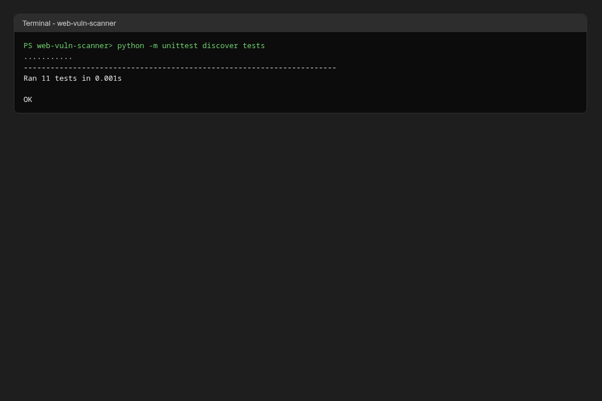
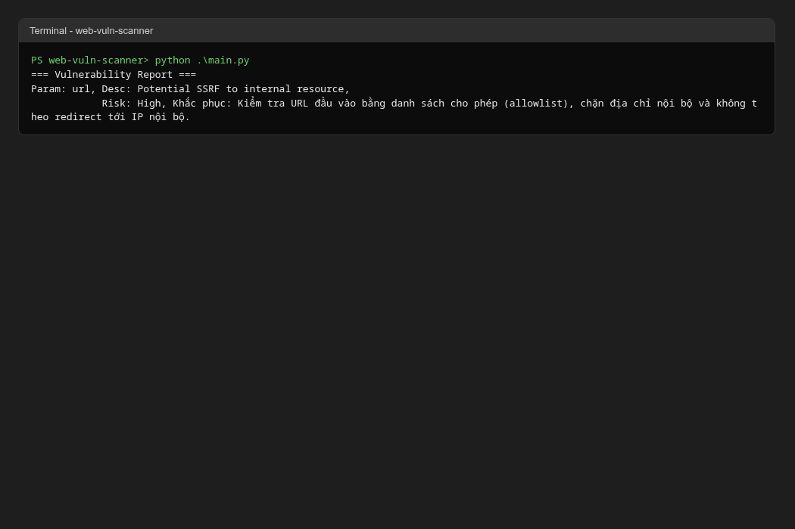
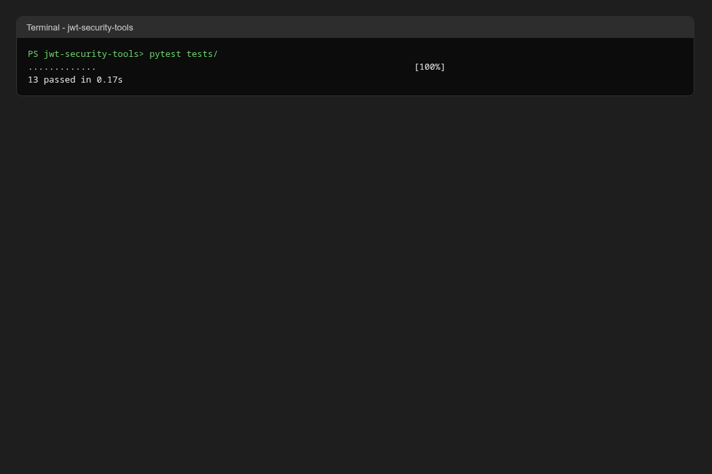
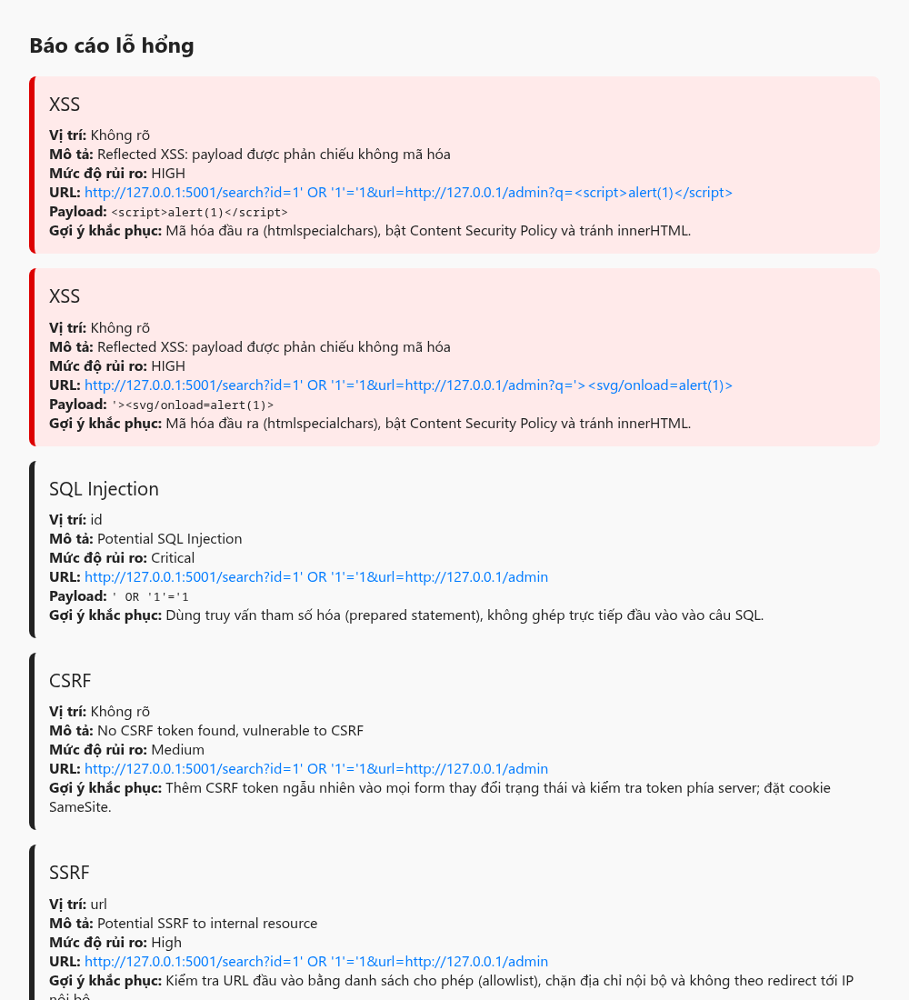
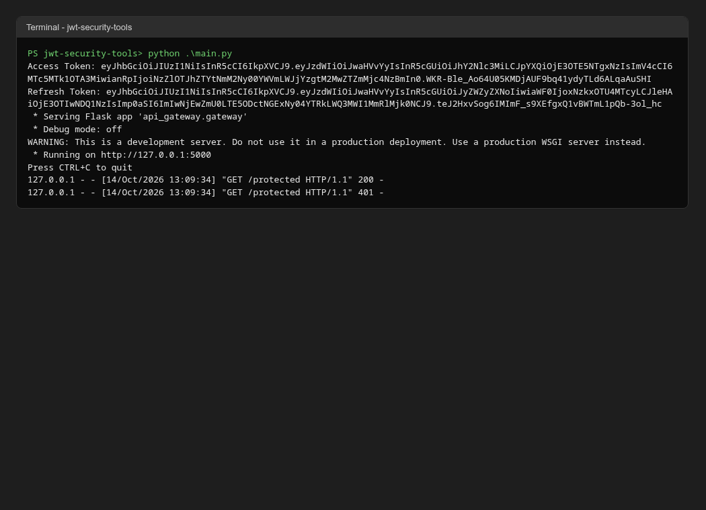
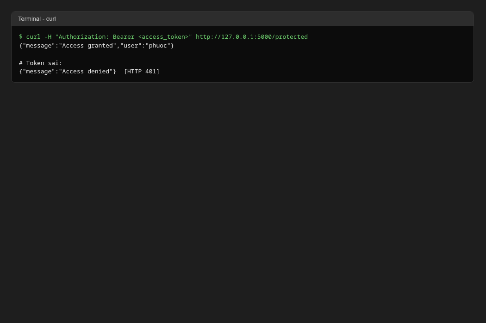

# BÁO CÁO THỰC HÀNH BÀI 4: BẢO MẬT WEB APP VÀ API

**Nội dung:** Xây dựng bộ công cụ quét lỗ hổng Web (`web-vuln-scanner`) và bộ công cụ bảo mật JWT (`jwt-security-tools`).
**Ngày thực hiện:** 14/10/2026

---

## 1. Mục tiêu

- Xây dựng công cụ quét lỗ hổng web gồm: XSS, SQL Injection, CSRF, SSRF và sinh báo cáo có gợi ý khắc phục.
- Xây dựng bộ công cụ bảo mật JWT gồm: kiểm tra token, brute force khóa yếu, OAuth 2.0 client, quản lý vòng đời token (phát hành, làm mới, thu hồi) và API Gateway có xác thực JWT.
- Kiểm thử bằng unittest/pytest, chạy chương trình chính và giao diện web.

## 2. Môi trường thực hiện

| Thành phần | Giá trị |
|---|---|
| Hệ điều hành | Linux (Fedora) |
| Python | 3.14 |
| Thư viện | Flask 3.1.3, requests, PyJWT 2.15.1, pytest 9.1.1 |
| Mục tiêu kiểm thử | Trang cục bộ `http://127.0.0.1:5001/search` mô phỏng lỗ hổng reflected XSS (phản hồi query string không mã hóa) |

> Ghi chú: Bài lab gốc dùng `testphp.vulnweb.com` để kiểm thử. Báo cáo này dùng một trang cục bộ để kết quả có thể tái lập và không phụ thuộc vào mạng ngoài.

## 3. Cấu trúc thư mục

```
Bai4/
├── web-vuln-scanner/
│   ├── __init__.py
│   ├── main.py
│   ├── requirements.txt         (Flask, requests)
│   ├── scanners/                (xss_scanner, sql_injection_tester, csrf_detector, ssrf_tester)
│   ├── report/                  (report_generator)
│   ├── ui/                      (app.py, templates/index.html, templates/result.html)
│   └── tests/                   (test_xss, test_sql_injection, test_csrf, test_ssrf, test_report)
├── jwt-security-tools/
│   ├── main.py
│   ├── requirements.txt         (PyJWT, requests, flask, pytest)
│   ├── pytest.ini
│   ├── api_gateway/             (gateway.py)
│   ├── jwt_cracker/             (cracker.py)
│   ├── jwt_validator/           (validator.py)
│   ├── oauth_client/            (client.py)
│   ├── token_manager/           (manager.py)
│   └── tests/                   (test_api_gateway, test_cracker, test_oauth_client, test_token_manager, test_validator)
└── images/                 (ảnh minh họa, xem mục 5)
```

## 4. Kết quả kiểm thử

### 4.1 Web Vulnerability Scanner

| Bước | Lệnh | Kết quả |
|---|---|---|
| Unit test | `python -m unittest discover tests` | 11 tests, **OK** |
| Chương trình chính | `python main.py` | In báo cáo, có gợi ý khắc phục, không còn dòng CSRF báo nhầm |
| Giao diện web | `python ui/app.py`, quét `http://127.0.0.1:5001/search?...` với đủ 4 công cụ | Phát hiện 2 XSS (HIGH), 1 SQL Injection (Critical), 1 CSRF (Medium), 1 SSRF (High); mỗi mục có gợi ý khắc phục |

### 4.2 JWT Security Tools

| Bước | Lệnh | Kết quả |
|---|---|---|
| Unit test | `pytest tests/` | **13 passed** |
| Phát hành token | `JWT_SECRET=<khóa> python main.py` | Sinh Access Token và Refresh Token, khởi động API Gateway tại cổng 5000 |
| Gọi API với token hợp lệ | `curl -H "Authorization: Bearer <access_token>" http://127.0.0.1:5000/protected` | `{"message":"Access granted","user":"phuoc"}` (HTTP 200) |
| Gọi API với token sai | `curl -H "Authorization: Bearer invalid" ...` | `{"message":"Access denied"}` (HTTP 401) |

Khóa bí mật được đọc từ biến môi trường `JWT_SECRET`, không còn ghi trong mã nguồn. Khi chưa đặt biến, chương trình dừng và báo lỗi.

## 5. Ảnh minh họa

**Hình 1. Unit test web scanner (11 tests OK)**


**Hình 2. Chạy chương trình chính web scanner**


**Hình 3. Unit test JWT security tools (13 passed)**


**Hình 4. Giao diện quét lỗ hổng**


**Hình 5. Báo cáo kết quả quét (có gợi ý khắc phục)**


**Hình 6. Chạy main.py JWT và sinh token**


**Hình 7. Xác thực API bằng JWT qua curl**


> Các ảnh 01, 02, 03, 06, 07 là ảnh render từ đúng output terminal, không phải ảnh chụp cửa sổ hệ điều hành. Ảnh 04 và 05 chụp từ trình duyệt.

## 6. Đối chiếu yêu cầu

| Yêu cầu trong đề | Hiện trạng | Đánh giá |
|---|---|---|
| Cấu trúc thư mục web-vuln-scanner | Đủ `report`, `scanners`, `tests`, `ui`, `__init__.py`, `main.py`, `requirements.txt` | Đạt |
| XSSScanner dùng thư viện payload chuẩn hóa | 2 payload, kiểm tra payload phản chiếu nguyên văn trong phản hồi | Đạt (mức cơ bản) |
| SQLInjectionTester trên nhiều DBMS | Payload nhóm theo MySQL, PostgreSQL, MSSQL, Oracle, SQLite; mỗi kết quả ghi rõ `dbms` | Đạt (mức phát hiện theo chuỗi, xem mục 7) |
| CSRFDetector phân tích khả năng bảo vệ CSRF | Tìm CSRF token trong HTML của **trang thật** được quét | Đạt |
| SSRFTester phát hiện endpoint truy cập nội bộ | Nhận diện 127.0.0.1, localhost, dải IP private | Đạt |
| ReportGenerator: mô tả, mức độ rủi ro, gợi ý khắc phục | Mỗi lỗ hổng có `desc`, `risk`, `remediation` và hiển thị trên giao diện | Đạt |
| Cấu trúc thư mục jwt-security-tools | Đủ các thư mục, `__init__.py`, `main.py`, `pytest.ini`, `requirements.txt` | Đạt |
| JWTValidator kiểm tra "toàn diện tính hợp lệ và độ an toàn" | Kiểm tra header `alg` (chặn `none` và nhầm khóa), bắt buộc `exp`/`iat`, chữ ký, hết hạn, và cảnh báo khóa yếu (< 32 byte) | Đạt |
| JWTCracker brute force khóa yếu | Đọc wordlist, thử đa luồng | Đạt |
| OAuthClient theo luồng chuẩn | Tạo auth URL và đổi code lấy token | Đạt (mức cơ bản) |
| TokenManager: phát hành, làm mới, thu hồi refresh token | Có `generate_tokens`, `refresh_access_token`, `revoke_refresh_token` | Đạt |
| APIGateway xác thực bằng JWT | Route `/protected` kiểm tra Bearer token | Đạt |
| Chạy unittest / pytest, chạy main, chạy web UI | Đã chạy, kết quả ở mục 4 | Đạt |
| Commit và push lên remote | Không kiểm tra được trong thư mục này (không có `.git`) | Chưa xác minh |

## 7. Các lỗi đã sửa

Các lỗi dưới đây được phát hiện khi đối chiếu và chạy lại chương trình, rồi sửa trong source.

1. **CSRF bị báo nhầm là lỗ hổng.** `ReportGenerator` nay bỏ qua kết quả `csrf_protected: True`. Trước đó `main.py` in dòng `Desc: None, Risk: None` ngay cả khi trang đã có CSRF token.
2. **Giao diện CSRF không kiểm tra trang thật.** `ui/app.py` trước đây quét form rỗng cố định. Nay tải đúng URL người dùng nhập và quét HTML đó. Nếu không tải được trang, báo rõ "không tải được" thay vì kết luận có/không có lỗi.
3. **Thiếu gợi ý khắc phục.** Mỗi công cụ thêm trường `remediation`, và `result.html` hiển thị mục "Gợi ý khắc phục".
4. **SQLi chỉ có payload chung.** `SQLInjectionTester` nay có payload theo từng DBMS (MySQL, PostgreSQL, MSSQL, Oracle, SQLite). Đã loại payload `DROP TABLE` vì là lệnh phá hủy, không phù hợp để quét.
5. **Kết quả không có loại lỗ hổng.** SQLi, SSRF, CSRF nay có khóa `type`, nên giao diện không còn hiển thị "Lỗ hổng chưa xác định". Thêm style cho mức `Critical`.
6. **Bắt lỗi quá rộng.** `XSSScanner` không còn `except Exception: pass`. Nay chỉ bắt `requests.RequestException` và ghi log cảnh báo.
7. **Thiếu thu hồi refresh token.** `TokenManager` thêm `jti` cho mỗi token và `revoke_refresh_token`. Refresh token đã thu hồi không còn làm mới được.
8. **`refresh_access_token` văng exception.** Token sai chữ ký nay trả `None` thay vì làm chương trình dừng.
9. **Thiếu kiểm tra an toàn trong JWTValidator.** Thêm kiểm tra thuật toán trong header (chặn `alg=none` và nhầm khóa RS256 sang HS256), bắt buộc `exp` và `iat`, và cảnh báo khóa yếu.
10. **Khóa bí mật viết cứng trong mã nguồn.** `main.py` đọc `JWT_SECRET` từ biến môi trường. Các test dùng `secrets.token_urlsafe(32)` thay cho chuỗi cố định. Đã kiểm tra: không còn `secret = "..."` nào trong source (trừ chuỗi `"short"` có chủ đích trong test cảnh báo khóa yếu).
11. **Dùng `datetime.utcnow()` đã deprecated.** Thay bằng `datetime.now(timezone.utc)`.
12. **Cảnh báo bandit trong bài.** `OAuthClient.get_token` thêm `timeout=10` cho `requests.post`. `ui/app.py` chỉ bật chế độ debug của Flask khi đặt `FLASK_DEBUG=1`, thay vì luôn bật `debug=True`.

## 8. Hạn chế còn lại

- **Phát hiện SQLi và SSRF vẫn dựa trên chuỗi trong URL.** Hai công cụ chưa gửi payload và đọc phản hồi để so sánh hành vi của server. Đây là phạm vi cần mở rộng nếu muốn kiểm thử thực tế hơn.
- **XSS chỉ có 2 payload** và chỉ kiểm tra phản chiếu nguyên văn. Không phát hiện được XSS DOM-based hay XSS đã được mã hóa một phần.
- **Danh sách thu hồi refresh token nằm trong bộ nhớ.** Khi tiến trình dừng, danh sách mất. Cần lưu xuống cơ sở dữ liệu nếu dùng thực tế.
- **Chưa xác minh được commit và push** vì thư mục này không có `.git`.
- **Ảnh terminal là ảnh render từ output**, không phải ảnh chụp cửa sổ hệ điều hành.

## 9. Kết luận

Cả hai bộ công cụ đã đáp ứng các yêu cầu của đề, sau khi sửa các lỗi nêu ở mục 7. Kiểm thử: 11/11 unit test của web scanner và 13/13 test của JWT security tools đều đạt. Chương trình chính và giao diện web chạy đúng, API Gateway trả 200 với token hợp lệ và 401 với token sai. Các hạn chế còn lại được liệt kê ở mục 8.
