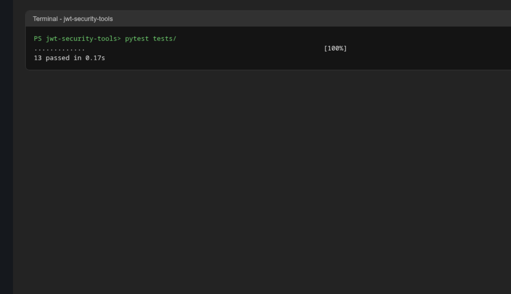
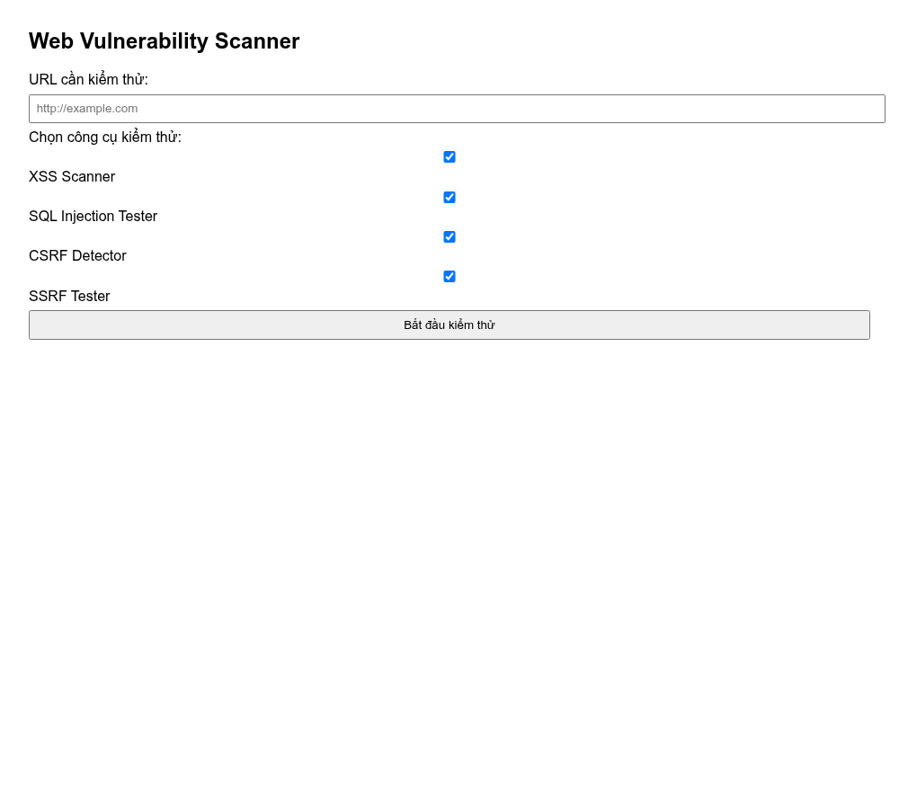

# Bài 4: Bảo mật Web App và API

Bài thực hành gồm hai bộ công cụ:

- **web-vuln-scanner**: quét lỗ hổng XSS, SQL Injection, CSRF, SSRF và sinh báo cáo có gợi ý khắc phục.
- **jwt-security-tools**: kiểm tra JWT, brute force khóa yếu, OAuth 2.0 client, quản lý vòng đời token và API Gateway có xác thực JWT.


## Yêu cầu

- Python 3.9 trở lên

## web-vuln-scanner

```bash
cd web-vuln-scanner
pip install -r requirements.txt
```

Chạy unit test:

```bash
python -m unittest discover tests
```

Chạy chương trình chính (dùng dữ liệu mẫu):

```bash
python main.py
```

Chạy giao diện web tại http://127.0.0.1:5000:

```bash
python ui/app.py
```

Nhập URL cần kiểm thử, chọn công cụ rồi bấm "Bắt đầu kiểm thử".

> Chỉ quét các trang bạn có quyền kiểm thử, ví dụ máy chủ của chính bạn hoặc trang được cung cấp để luyện tập.

## jwt-security-tools

```bash
cd jwt-security-tools
pip install -r requirements.txt
```

Chạy test:

```bash
pytest tests/
```

Khóa bí mật được đọc từ biến môi trường `JWT_SECRET`. Chương trình sẽ dừng nếu chưa đặt biến này.

Trên Linux/macOS:

```bash
export JWT_SECRET="<chuỗi bí mật dài, tối thiểu 32 ký tự>"
python main.py
```

Trên Windows PowerShell:

```powershell
$env:JWT_SECRET = "<chuỗi bí mật dài, tối thiểu 32 ký tự>"
python .\main.py
```

`main.py` in ra Access Token và Refresh Token, rồi khởi động API Gateway tại http://127.0.0.1:5000. Gọi thử:

```bash
curl -H "Authorization: Bearer <access_token>" http://127.0.0.1:5000/protected
```

Token hợp lệ trả về `Access granted`, token sai trả về HTTP 401.

## Kết quả chạy thử

Unit test JWT security tools (13 passed):



Giao diện quét lỗ hổng:



Báo cáo kết quả quét, có gợi ý khắc phục:


