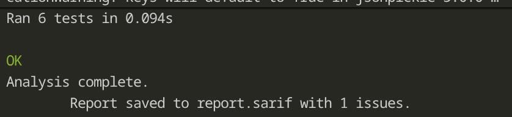
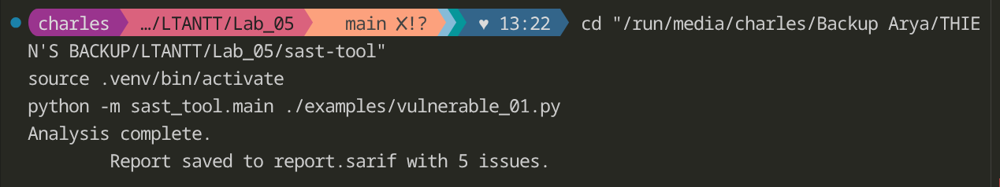
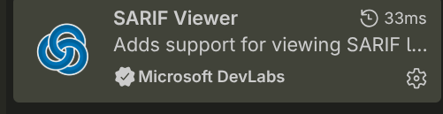
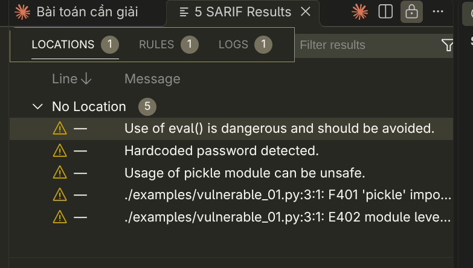
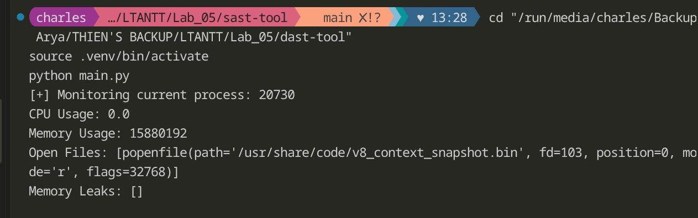
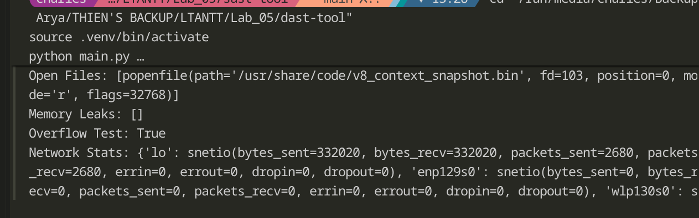
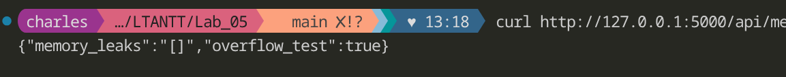
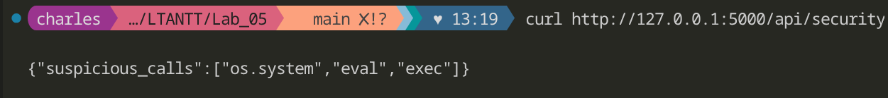
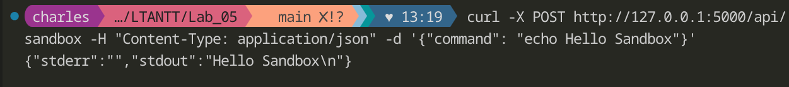

# Bài 5 – Phân tích và kiểm thử bảo mật

| | |
|---|---|
| **Môn học** | Lập trình An ninh thông tin |
| **Buổi** | 5 – Phân tích và kiểm thử bảo mật (mục 5.1 – 5.4) |
| **Sinh viên** | Bùi Quang Thiện – 2387700065 |

## 1. Mục tiêu

Xây dựng hai công cụ bằng Python:

- **sast-tool**: phân tích tĩnh (SAST) mã nguồn Python bằng cây cú pháp AST, so khớp mẫu và flake8. Kết quả xuất theo định dạng SARIF 2.1.0.
- **dast-tool**: giám sát tiến trình khi đang chạy (CPU, bộ nhớ, file mở, kết nối mạng), chạy lệnh trong thư mục cách ly và phơi kết quả qua API Flask.

## 2. Cách chạy

### 4.1 SAST-tool

```bash
cd sast-tool
python3 -m venv .venv && source .venv/bin/activate
pip install -r requirements.txt
python -m unittest discover tests
python -m sast_tool.main ./examples/vulnerable_01.py
```

Báo cáo được ghi vào `report.sarif` trong thư mục đang chạy. Mở file này bằng extension **SARIF Viewer** trong VS Code để xem danh sách issue.

### 4.2 DAST-tool

```bash
cd dast-tool
python3 -m venv .venv && source .venv/bin/activate
pip install -r requirements.txt
python -m unittest discover -s tests
python main.py
python app.py                      # giữ terminal này chạy
```

Ở terminal khác, gọi API:

```bash
curl http://127.0.0.1:5000/api/monitor
curl http://127.0.0.1:5000/api/memory
curl http://127.0.0.1:5000/api/network
curl http://127.0.0.1:5000/api/security
curl -X POST http://127.0.0.1:5000/api/sandbox \
     -H "Content-Type: application/json" \
     -d '{"command": "echo Hello Sandbox"}'
```

## 3. Kết quả thực hiện

### 5.1 SAST-tool

Unit test (6 test) và quét `vulnerable_02.py` (1 issue):



Quét `vulnerable_01.py` cho ra 5 issue:



| # | Issue | Nguồn phát hiện |
|---|---|---|
| 1 | Use of eval() is dangerous and should be avoided. | ASTAnalyzer |
| 2 | Hardcoded password detected. | VulnPatternMatcher |
| 3 | Usage of pickle module can be unsafe. | VulnPatternMatcher |
| 4 | F401 'pickle' imported but unused | CodeQualityChecker (flake8) |
| 5 | E402 module level import not at top of file | CodeQualityChecker (flake8) |

Mở báo cáo bằng SARIF Viewer:





### 5.2 DAST-tool

`main.py` in ra thông tin của tiến trình hiện tại: PID, CPU, bộ nhớ, file đang mở, memory leak, overflow test, thống kê mạng, hàm nguy hiểm và kết quả sandbox.





Kết quả các endpoint của Flask API:







| Endpoint | Kết quả |
|---|---|
| `GET /api/memory` | `memory_leaks: "[]"`, `overflow_test: true` |
| `GET /api/security` | `suspicious_calls: ["os.system", "eval", "exec"]` |
| `POST /api/sandbox` | `stdout: "Hello Sandbox\n"`, `stderr: ""` |
