# Bài 6 – Bảo mật với DevSecOps

| | |
|---|---|
| **Môn học** | Lập trình An ninh thông tin |
| **Buổi** | 6 – Bảo mật với DevSecOps (mục 6.1 – 6.2) |
| **Sinh viên** | Bùi Quang Thiện – 2387700065 |
| **Dự án GitLab** | https://gitlab.com/bquangthien25-hub/my-pipeline-tutorial-project |

## 1. Kết quả thực hiện

### Tạo dự án trên GitLab

Dự án `My Pipeline Tutorial Project` (nhánh `main`) được tạo dưới tên người dùng, có README khởi tạo:

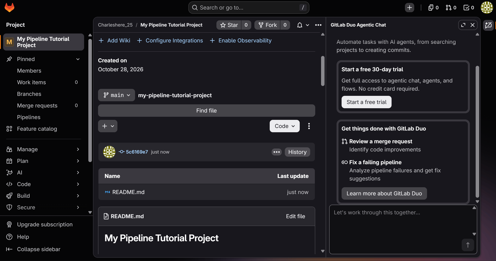

### 6.2.1 Tệp `.gitlab-ci.yml`

Tệp `.gitlab-ci.yml` (4 job: `build-job`, `test-job1`, `test-job2`, `deploy-prod`) đã được commit lên nhánh `main`:

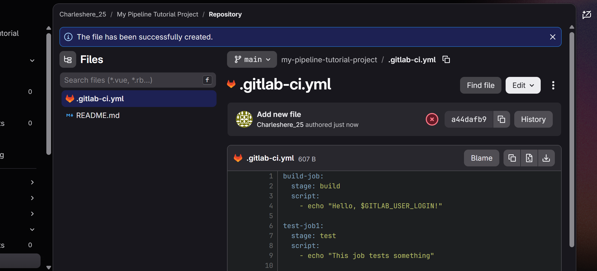

Pipeline #2997728093 của commit này **không chạy job nào** (0 jobs, trạng thái Failed). GitLab yêu cầu **xác minh danh tính** (“Verify your identity to run this pipeline”) trước khi cho chạy pipeline. Lỗi nằm ở bước xác minh tài khoản, không phải ở cú pháp tệp YAML:

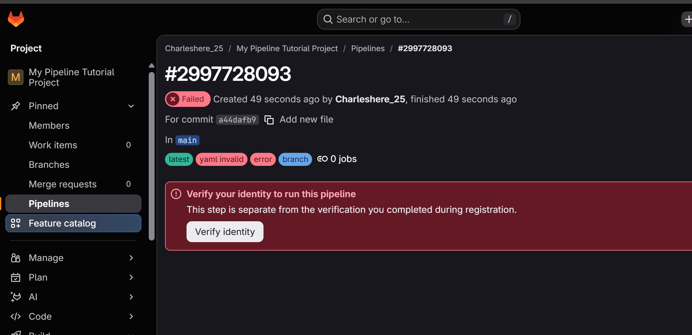

Khi bấm **Verify identity**, GitLab chuyển tới trang `gitlab.com/-/identity_verification` với bước 1/2 là **Credit card Verification** (nhập tên trên thẻ, số thẻ, ngày hết hạn, CVV). Em không nhập thông tin thẻ ngân hàng cho bài thực hành này nên pipeline không chạy được:

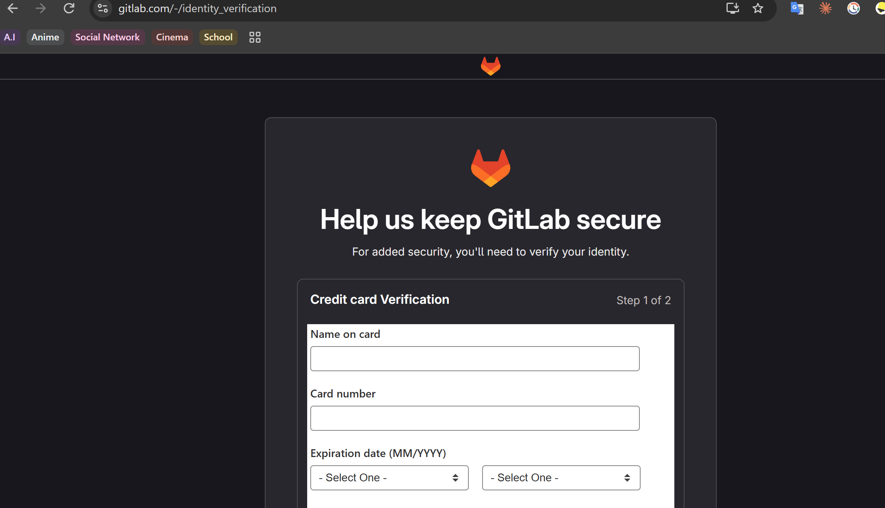

### 6.2.2 Trang Docusaurus

Đã tạo dự án Docusaurus (template `classic`, JavaScript), chuyển các tệp từ `website/` lên thư mục gốc, cấu hình `url`/`baseUrl`, rồi commit và push lên GitLab (commit `ee65b8a`).

Pipeline #2997782129 của commit này cũng bị chặn giống 6.2.1: trạng thái Failed, 0 job, yêu cầu “Verify your identity”:

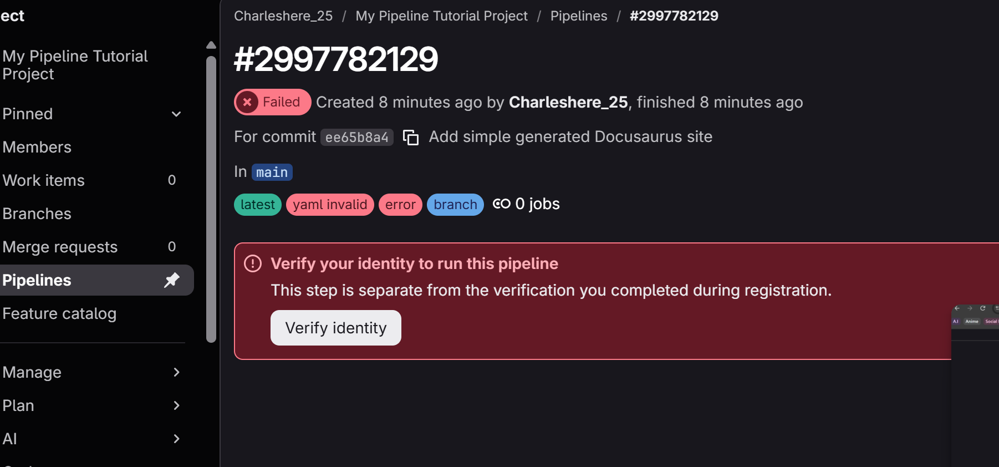

Build và chạy thử trên máy (`npm run build`, `npm run serve`), truy cập `http://localhost:3000/my-pipeline-tutorial-project/`:

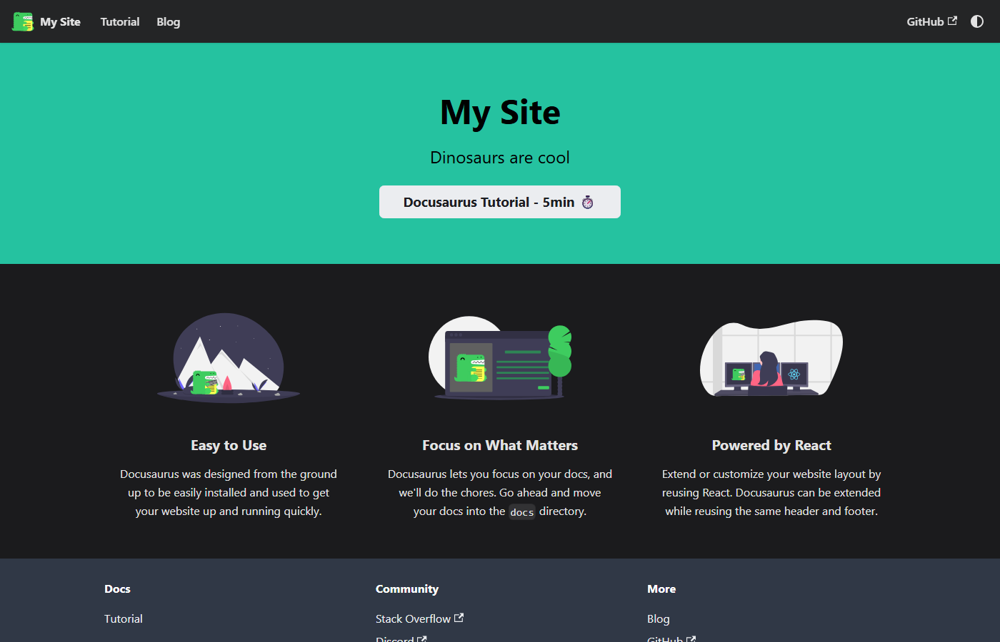

## 2. Phương án thay thế: GitHub Actions

Do GitLab chặn chạy pipeline (cả tài khoản thứ hai cũng bị yêu cầu xác minh), em dựng pipeline tương đương trên GitHub Actions. Đây là **phương án thay thế, khác nền tảng so với đề bài** (đề dùng GitLab CI/CD).

Tài khoản GitLab thứ hai cũng bị chặn với thông báo “Before you can run pipelines, we need to verify your account”:

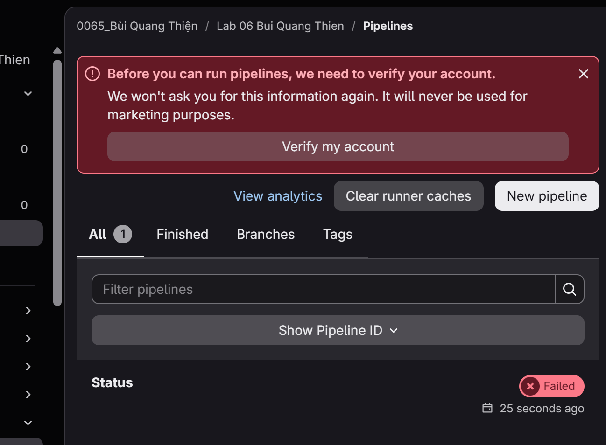

Workflow: `.github/workflows/lab06-pages.yml` (ở gốc repo, vì GitHub chỉ đọc thư mục này ở gốc).

| GitLab CI (`.gitlab-ci.yml`) | GitHub Actions (`lab06-pages.yml`) |
|---|---|
| `stages: build, deploy` | `pages` có `needs: build-job` (chạy sau) |
| `build-job` (`image: node`, `npm install`, `npm run build`) | `build-job` (`setup-node`, `npm ci`, `npm run build`) |
| `artifacts: paths: build/` | `actions/upload-pages-artifact` với thư mục `build` |
| job `pages` (`mv build/ public/`) | job `pages` dùng `actions/deploy-pages` |

Workflow chạy khi push thay đổi trong `Buoi6/Lab06/pipeline-tutorial/` hoặc chạy tay (`workflow_dispatch`). Cần bật **Settings > Pages > Source: GitHub Actions** trên repo trước khi chạy. Địa chỉ dự kiến: `https://bquangthien25-hub.github.io/TH_LTANTT_2387700065/`.

Đã kiểm tra trên máy: `npm ci` và `npm run build` với cấu hình GitHub thành công, `build/index.html` có đường dẫn tài nguyên theo `/TH_LTANTT_2387700065/`, và file workflow đọc được bằng trình phân tích YAML.

### Kết quả chạy trên GitHub

Workflow chạy tay (`workflow_dispatch`) trên nhánh `master`, commit `1209fe1`. Cả hai job thành công: `build-job` (25s) rồi `pages` (12s), job `pages` hiển thị địa chỉ trang web:

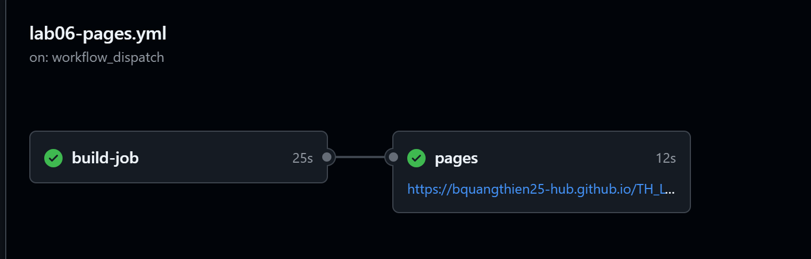

Log bước `npm run build` của `build-job` (`Generated static files in "build"`):

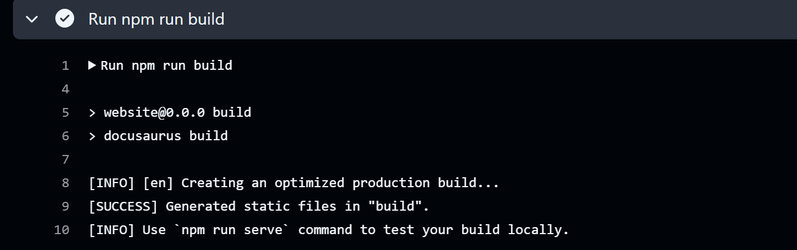

Job `pages` dùng `actions/deploy-pages@v4`, bước đặt địa chỉ môi trường cho ra `https://bquangthien25-hub.github.io/TH_LTANTT_2387700065/`. Log này có một cảnh báo (không phải lỗi) về việc các action nhắm Node.js 20 đang bị buộc chạy trên Node.js 24:

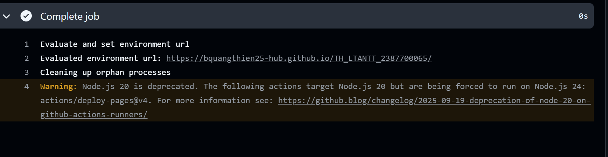

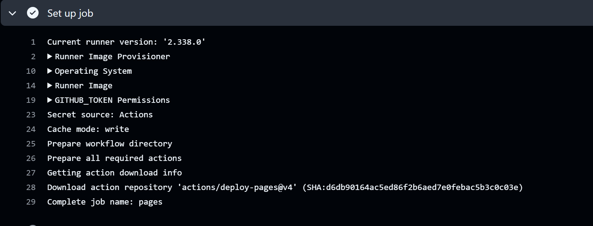

Trang web Docusaurus sau khi triển khai trên GitHub Pages (địa chỉ `bquangthien25-hub.github.io/TH_LTANTT_2387700065/`):

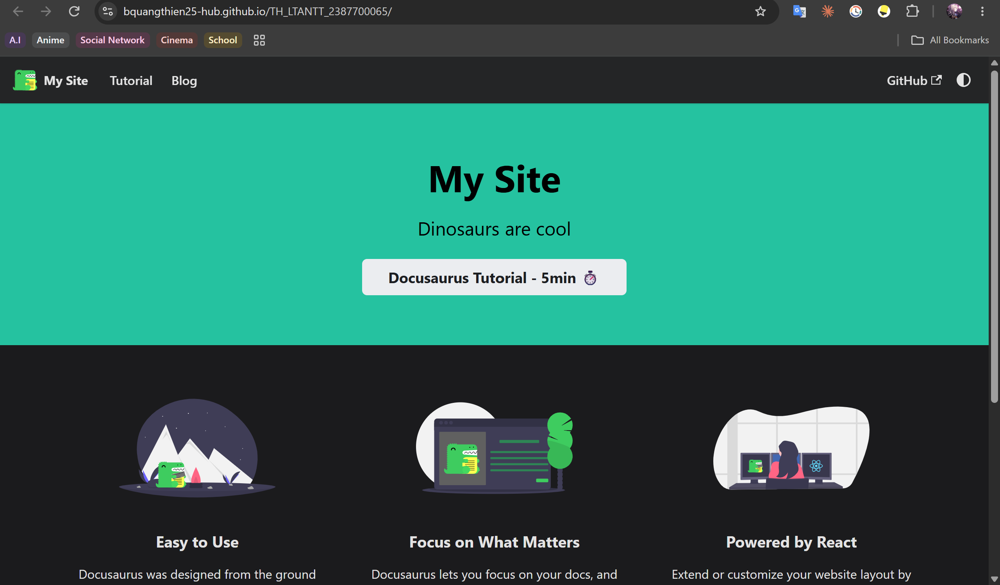

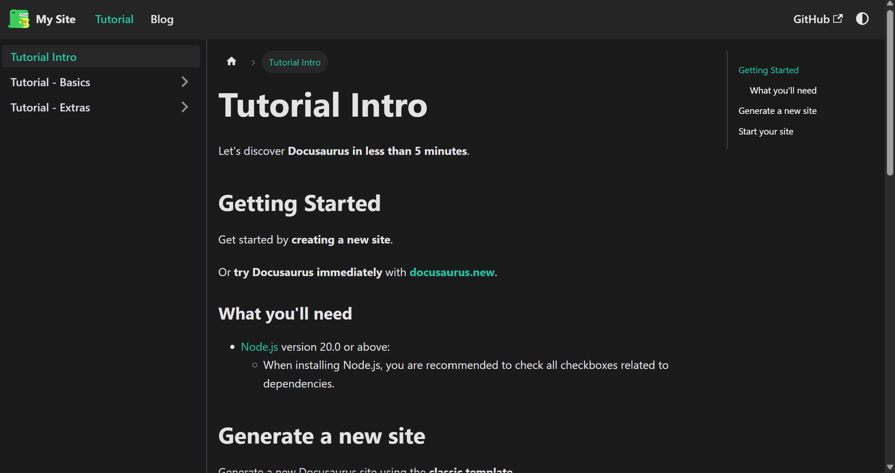

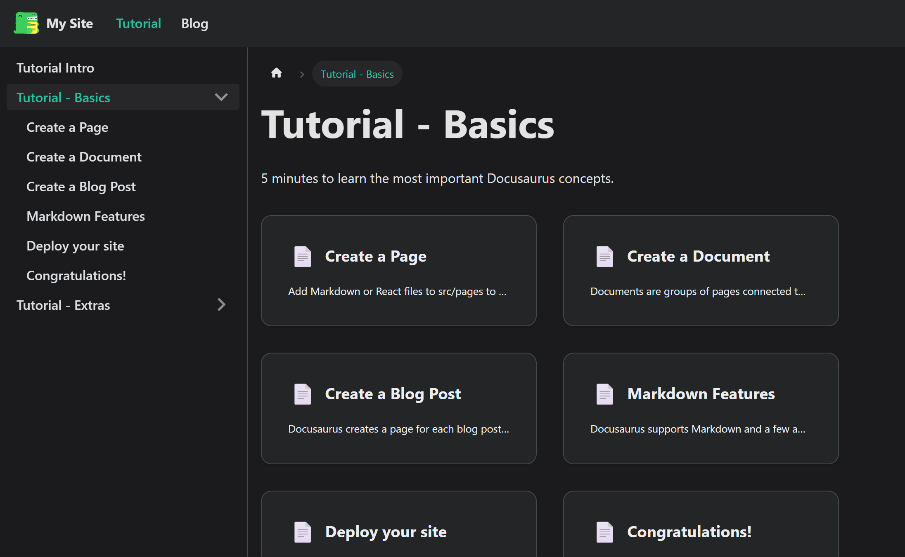

